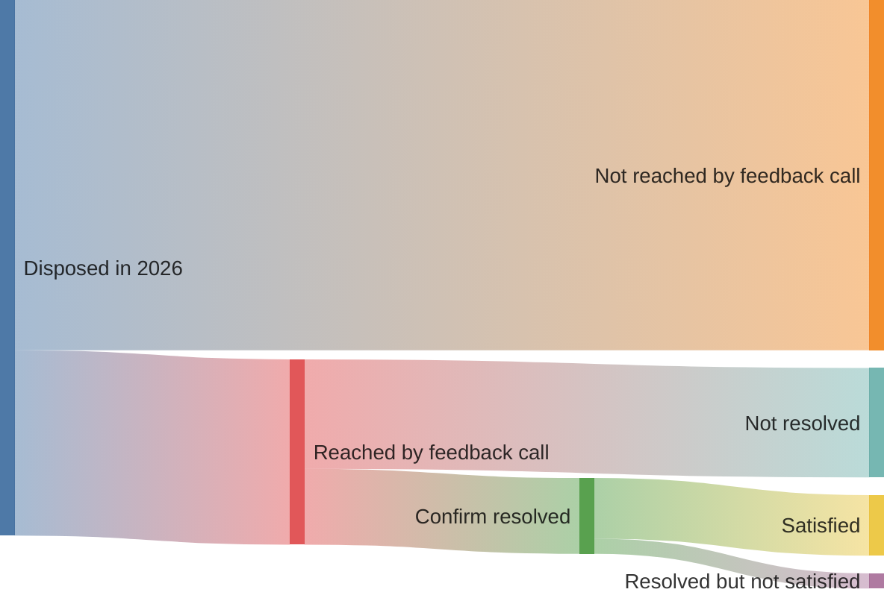
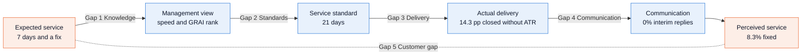

<p align="center"><a href="https://harveyspecter-cmd.github.io/sm-cpgrams/"></a></p>

<p align="center">
<a href="https://harveyspecter-cmd.github.io/sm-cpgrams/"><b>Open the interactive research story</b></a> ·
<a href="report/CPGRAMS_SM_Report_Group5.pdf">Submitted report</a> ·
<a href="report/CPGRAMS_SM_Technical_Report_Full.pdf">Technical report</a> ·
<a href="deck/CPGRAMS_SM_Group5_Deck.pdf">Deck</a> ·
<a href="data/">Raw data</a>
</p>

Service Management, BPGP 2025-27, Term IV, Indian Institute of Management Ahmedabad.
Group 5 is Fairy Pandit, Gopika Tejaswini Chintakuntla, Rahul Shyamal, Shivam Aggarwal and Sushant Gaurav.
Faculty are Prof. Rajesh Chandwani and Prof. Ankur Sinha.

## The story in five scenes

### 1. A promise of 21 days

CPGRAMS is the single window for grievances against every Central Ministry. It handled 20.26 million grievances between 2016 and February 2026. Since August 2024 each one must be disposed of within 21 days, or the citizen must get an interim reply. We asked a simple question. Does CPGRAMS keep that promise?

### 2. The government record says yes

The official numbers look healthy. By Little's Law the mean time in the system was 12.28 days in 2026 and 10.3 days by October 2026. Disposals ran at 100.52% of receipts across 34 months. Headline satisfaction was 79.91%.

<details>
<summary><b>Show the Little's Law working</b></summary>

$$W = \frac{L}{\lambda} = \frac{78{,}076}{235{,}082 \div 31} = 10.30 \text{ days}$$

L is the closing stock of October 2026 and λ is the daily disposal rate. Mean W by year was 14.99 days in 2024, 14.44 days in 2025 and 12.28 days in 2026. In all 33 monthly transitions the reported stock is higher than receipts minus disposals predicts, by 36,843 cases in total, so reopenings and transfers add hidden demand.

[Try it with any month](https://harveyspecter-cmd.github.io/sm-cpgrams/#c2)
</details>

<details>
<summary><b>Show why a 12 day mean still leaves a third of stock past 21 days</b></summary>

A single class of cases cannot give both a 12.28 day mean and 32% of open stock older than 21 days. Two classes can.

$$W = (1-q)\,m_1 + q\,m_2 \qquad P(T>21) = (1-q)\,e^{-21/m_1} + q\,e^{-21/m_2}$$

| Parameter | Value |
|---|---|
| Routine mean m₁ | 7 days |
| Complex mean m₂ | 35.7 days |
| Complex share q | 18.4% |
| Completions past 21 days | 14.3% |
| 95th percentile | 47.2 days |
| Service variability Cs² | 2.64 |

[Move the sliders yourself](https://harveyspecter-cmd.github.io/sm-cpgrams/#c3)
</details>

### 3. Citizens say no

We followed 24 grievances across 12 departments, coding 38 fields for each. Only 2 were actually fixed. Of 18 service KPIs only two pass, and both are the measures the portal itself reports.

<p align="center"><a href="https://harveyspecter-cmd.github.io/sm-cpgrams/#c5"></a></p>

### 4. DARPG's own phone calls bridge the gap

DARPG called 6,99,593 citizens after closure in 2026. Only 40.94% confirmed resolution and 32.72% were satisfied. The same grievances give four different success rates depending on what is counted.



<details>
<summary><b>Show the survey bounds</b></summary>

Only 34.6% of disposals were reached by phone. If none of the silent majority was resolved, true resolution is 14.2%. If all of them were, it is 79.6%.

$$\frac{286{,}429}{20{,}22{,}066} = 14.2\% \;\leq\; \text{resolved share} \;\leq\; \frac{286{,}429 + 13{,}22{,}473}{20{,}22{,}066} = 79.6\%$$

Our cohort sits at 8.3%, just below the lower bound, as a self selected sample of complainants should.

[Drag the bound yourself](https://harveyspecter-cmd.github.io/sm-cpgrams/#c6)
</details>

<p align="center"><a href="https://harveyspecter-cmd.github.io/sm-cpgrams/#c6"></a></p>

### 5. Why the lenses disagree, and what to do

<p align="center"><a href="https://harveyspecter-cmd.github.io/sm-cpgrams/#c7"></a></p>



A two class model shows that 18.4% of grievances are complex and take five times longer, so 14.3% of completions pass 21 days even when the mean is 12 days. Ten departments hold 90.63% of cases aged 60 days or more. Within a ministry, faster closure without an Action Taken Report goes with more appeals. Pooling four GRO desks meets 21 days at 88% utilisation instead of 60%, which is 31.5% less capacity for the same promise.

<details>
<summary><b>Show the pooling calculation</b></summary>

Expected days to close with c pooled desks, using Erlang C scaled by the Allen Cunneen factor.

$$\text{Days} = W_q^{M/M/c} \times \frac{C_a^2 + C_s^2}{2} \times m_1 + m_1, \qquad C_a^2 = 0.0204,\; C_s^2 = 2.64,\; m_1 = 7$$

| Desks pooled | Highest utilisation that still meets 21 days |
|---|---|
| 1 | 60.1% |
| 2 | 77.5% |
| 4 | 87.7% |
| 8 | 93.4% |

Four pooled desks need 31.5% less capacity than one siloed desk for the same promise.

[Run the simulator](https://harveyspecter-cmd.github.io/sm-cpgrams/#c8)
</details>

<details>
<summary><b>Show the 18 citizen KPIs</b></summary>

| KPI | Measure | Value | Target |
|---|---|---|---|
| KPI-01 | Substantive resolution rate, direct cohort | 8.3 % | at least 85% |
| KPI-02 | Substantive resolution rate, individual cases | 16.7 % | at least 85% |
| KPI-03 | Nominal 21 day compliance, individual | 45.5 % | at least 90% |
| KPI-04 | Substantive 21 day compliance, individual | 18.2 % | at least 85% |
| KPI-05 | Nominal 21 day compliance, direct cohort | 21.7 % | at least 90% |
| KPI-06 | Substantive 21 day compliance, direct cohort | 8.7 % | at least 85% |
| KPI-07 | Hollow closure share among closures within 21 days | 60 % | at most 5% |
| KPI-08 | 21 day breach rate, direct cohort | 78.3 % | at most 10% |
| KPI-09 | Overall hollow closure rate, direct cohort | 83.3 % | at most 5% |
| KPI-10 | Mean time to disposal, strictly closed | 17 days | at most 21 |
| KPI-11 | Mean portal duration, all dated direct | 42.6 days | at most 21 |
| KPI-12 | Mean end to end citizen journey | 123 days | at most 30 |
| KPI-13 | Mean reassignments, exact known | 1 hops | at most 1 |
| KPI-14 | Resolution rate with zero reassignment | 50 % | at least 85% |
| KPI-15 | Resolution rate with one or more reassignment | 0 % | at least 75% |
| KPI-16 | External channel use | 100 % | at most 10% |
| KPI-17 | Mean outcome fairness score | 1 of 5 | at least 4 |
| KPI-18 | Digital confidence erosion | 66.7 % | at most 10% |

Live formulas are in `data/workbooks/CPGRAMS_Primary_Research_Raw_Data_Matrix.xlsx`.
</details>

We recommend citizen verified closure for a sample of cases, a single owner rule, pooled triage desks, a complex track with honest interim replies, tail alerts in the ten ministries that hold the backlog and a balanced scorecard that publishes true satisfaction beside disposal speed.

**CPGRAMS meets 21 days as a disposal standard, not as a resolution standard.**

## Try the numbers yourself

The [interactive research story](https://harveyspecter-cmd.github.io/sm-cpgrams/) ([source in docs/index.html](docs/index.html)) has every chart with hover detail and five live calculators.

| Calculator | What you can change |
|---|---|
| Little's Law | Any month, the pending stock and disposals |
| Two class tail model | Complex share and the mean days of each class |
| Backlog effect | The backlog ratio in the fixed effects regression |
| Survey bounds | How many silent citizens were really resolved |
| Pooling simulator | Desks pooled, utilisation and service variability |

## What is in this repository

| Folder | Contents |
|---|---|
| [`report/`](report/) | Submitted report and full technical report, PDF and Word |
| [`deck/`](deck/) | Presentation, PowerPoint and PDF |
| [`docs/`](docs/) | Interactive research story, a single self contained page |
| [`assets/`](assets/) | Animated infographics used on this page |
| [`data/raw/secondary/`](data/raw/secondary/) | Government data as CSV. DARPG monthly reports, GRAI tables, feedback funnels, CPENGRAMS, Lok Sabha ledgers |
| [`data/raw/primary/`](data/raw/primary/) | Citizen case matrix (25 units, 38 coded fields) and structured ratings |
| [`data/workbooks/`](data/workbooks/) | Secondary compendium with a findings summary, and the primary KPI workbook with live Excel formulas |
| [`code/`](code/) | Python pipeline that reproduces every number |
| [`outputs/`](outputs/) | `metrics.json`, analysis tables and figures written by the pipeline |

## Reproduce the analysis

```
pip install -r requirements.txt
python code/01_extract_raw_data.py
python code/02_analysis.py
python code/03_figures.py
python code/04_build_workbooks.py
```

1. `01_extract_raw_data.py` reads the two workbooks and writes the raw CSV files.
2. `02_analysis.py` computes Little's Law flows, the two class completion time model, the Pareto and Spearman tests, the panel regressions, the interrupted time series, the feedback funnel and survey bounds, the queue and pooling models and all 18 citizen KPIs. Results go to `outputs/metrics.json` and `outputs/tables/`.
3. `03_figures.py` draws every exhibit in `outputs/figures/`.
4. `04_build_workbooks.py` rebuilds the primary KPI workbook with live formulas and refreshes the hypothesis matrix and findings summary in the secondary workbook.

## Service management frameworks used

Service process matrix, RATER and SERVQUAL, the gap model, customer journeys versus touchpoints, Mr. BIV defect analysis and Pareto, standards versus expectations, the four tests of a good measure, the balanced scorecard, the service profit chain, the AMO model, regression with quadratic terms and fixed effects, Little's Law, M/M/1, Erlang C and G/G/c queues, pooling, the psychology of waiting and survey bias bounds.

## Data ethics

Citizen participants gave consent. Names, contact details and registration numbers are removed and each grievance carries a Case-XX-NN code. The cited case Case-PP-05 is kept in the register but excluded from every rate.
